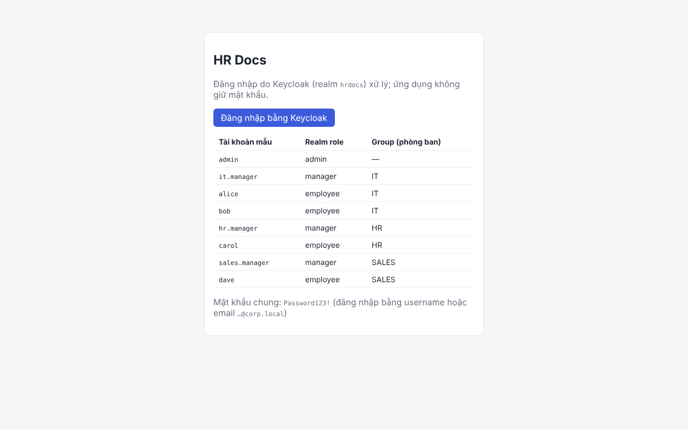
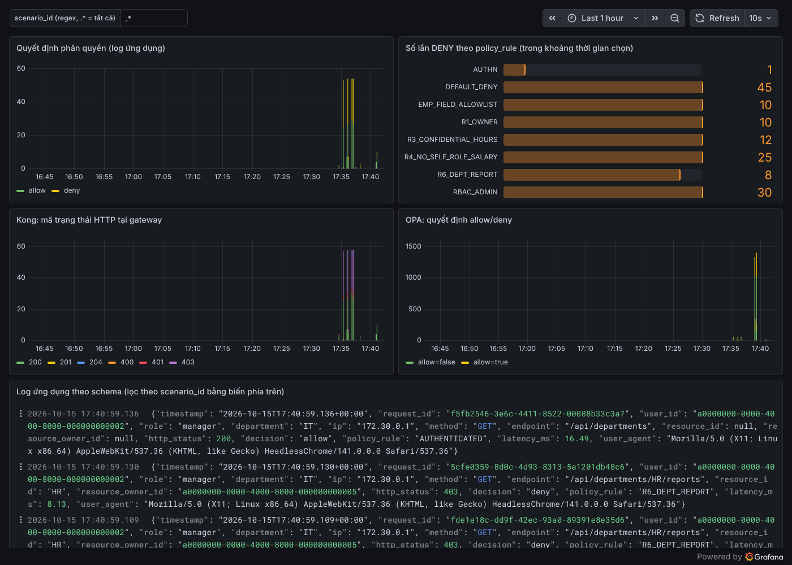

# HR Docs – bản dựng trên stack IAM (FastAPI · Keycloak · OPA · Kong · Loki/Grafana)

Ứng dụng quản lý hồ sơ/tài liệu nội bộ dùng làm môi trường pentest phân quyền, dựng lại theo bảng
"So sánh lựa chọn công nghệ":

| Thành phần | Chọn | Trong thư mục này |
|---|---|---|
| Ứng dụng mẫu | FastAPI (Python) | `api/` |
| Identity Provider | Keycloak (OAuth2/OIDC, realm role) | `keycloak/realm-hrdocs.json` |
| Policy Engine | OPA/Rego, có decision log (Casbin dự phòng) | `policies/opa/`, `api/app/authz/casbin/` |
| API Gateway | Kong (plugin JWT + log HTTP) | `kong/kong.template.yml` |
| Kho log | Loki + Grafana (xuất JSON cho TV3) | `observability/`, `scripts/export_logs.py` |

**Chi tiết từng công cụ nằm ở file nào, làm gì: xem [TOOLS.md](TOOLS.md).**

Đây là **bản tham chiếu được bảo mật đúng** (phân quyền chuẩn theo thiết kế). Bạn tự cài lỗ hổng dần
để thực hành; `scripts/check_authz.py` sẽ báo FAIL ở đúng dòng bị ảnh hưởng.

## Thiết kế API và quyền

| Endpoint | Mô tả | Quyền | Quy tắc |
|---|---|---|---|
| `GET /api/documents/{id}` | Xem tài liệu | Chủ sở hữu, Manager cùng phòng ban, Admin | R1, R2, R3 |
| `PUT /api/documents/{id}` | Sửa tài liệu | Chủ sở hữu, Admin | R1 |
| `DELETE /api/documents/{id}` | Xóa tài liệu | Admin, từ IP nội bộ | R5 |
| `GET /api/employees/{id}` | Xem hồ sơ | Bản thân, Manager cùng phòng ban, Admin | |
| `PATCH /api/employees/{id}` | Cập nhật hồ sơ | Bản thân (fullName, phone, address), Admin | R4 |
| `GET /api/departments/{id}/reports` | Báo cáo phòng ban | Manager của phòng ban đó, Admin | R6 |
| `POST /api/admin/users` | Tạo tài khoản (Keycloak + Mongo) | Admin, từ IP nội bộ | R5 |
| `GET /api/admin/audit` | Xem audit log | Admin, từ IP nội bộ | R5 |

Phụ trợ cho giao diện: `GET /api/auth/me`, `GET/POST /api/documents`, `GET /api/employees`, `GET /api/departments`.
Tài liệu OpenAPI tự sinh: http://localhost:8000/api/docs.

Quy tắc ABAC: R1 user chỉ đọc/sửa tài liệu của mình · R2 manager đọc tài liệu cùng phòng · R3 tài liệu
`confidential` chỉ đọc trong 08:00–18:00 · R4 không ai tự sửa `role`/`salary` của mình · R5 xóa và quản trị
chỉ từ dải IP nội bộ · R6 manager không xem báo cáo phòng ban khác. Mã quy tắc (`R1_OWNER`,
`R3_CONFIDENTIAL_HOURS`, …) xuất hiện trong lỗi 403 và trường `policy_rule` của log.

## Chạy

Cần Docker Desktop (Windows/macOS) hoặc Docker Engine + Compose v2. Node 18+ nếu chạy frontend trên máy.

```bash
cp .env.example .env              # sửa MONGO_URI trỏ tới Mongo server của bạn
docker compose up -d --build      # Keycloak, Kong, FastAPI, OPA, Loki, Alloy, Grafana
docker compose run --rm api python -m app.seed    # nạp dữ liệu mẫu vào Mongo

cd frontend && npm install && npm run dev         # http://localhost:5173
```

- **MongoDB riêng**: mặc định `MONGO_URI=mongodb://host.docker.internal:27017` (Mongo chạy trên máy host).
  Mongo ở máy khác thì ghi địa chỉ đó. Không có Mongo: đặt `MONGO_URI=mongodb://mongo:27017` và chạy
  `docker compose --profile local-mongo up -d`.
- **Không cài Node**: `docker compose --profile web up -d` chạy luôn frontend trong Docker.
- Lần đầu Keycloak mất khoảng 30–60 giây để import realm; `config-init` chờ xong mới cho Kong và OPA khởi động.

| Dịch vụ | Địa chỉ | Đăng nhập |
|---|---|---|
| Web (React) | http://localhost:5173 | tài khoản mẫu bên dưới |
| API qua Kong | http://localhost:8000/api (docs: `/api/docs`) | Bearer token Keycloak |
| Keycloak admin | http://localhost:8080/admin | `admin` / `admin` |
| Grafana | http://localhost:3000 | `admin` / `admin` |
| Kong Admin API | http://127.0.0.1:8001 | (chỉ localhost) |
| OPA | http://127.0.0.1:8181 | (chỉ localhost) |
| Loki | http://127.0.0.1:3100 | |

Tài khoản mẫu (mật khẩu chung `Password123!`, đăng nhập bằng username hoặc email `…@corp.local`):

| Username | Realm role | Phòng ban (group) |
|---|---|---|
| admin | admin | – |
| it.manager / hr.manager / sales.manager | manager | IT / HR / SALES |
| alice, bob | employee | IT |
| carol | employee | HR |
| dave | employee | SALES |



## Kiểm thử

```bash
# 1. Unit test chính sách OPA (26 test, gồm nhánh ngoài giờ và IP ngoài)
docker run --rm -v "$PWD/policies/opa:/p" openpolicyagent/opa:1.21.2 test /p -v

# 2. Ma trận quyền end-to-end qua Kong (55 kiểm tra; chạy lại seed trước mỗi lần)
docker compose run --rm api python -m app.seed && python scripts/check_authz.py

# 3. Test FastAPI không cần Docker + so sánh OPA với Casbin
cd api && pip install -r requirements-dev.txt
pytest                                                                     # 19 test, engine Casbin
OPA_URL=http://localhost:8181/v1/data/hrdocs/authz/decision pytest tests/test_policy_parity.py
```

Kết quả khi dựng: `opa test` 26/26, `check_authz.py` 55/55 với OPA (cả trong và ngoài giờ làm việc) và với
Casbin, pytest 20/20 (gồm so sánh OPA–Casbin trên mọi tổ hợp đầu vào).

Thử nhánh R5 bị chặn: trình duyệt trên máy host đi vào Kong với IP `172.30.0.1`. Bỏ `172.16.0.0/12` khỏi
`INTERNAL_CIDRS` trong `.env`, rồi `docker compose up -d --force-recreate config-init opa kong api` → mọi
`/api/admin/*` và DELETE tài liệu bị Kong trả 403 `R5_INTERNAL_IP`.

Thử nhánh R3: đổi `WORK_HOURS_START/END` trong `.env` rồi recreate như trên.

## Log

Mỗi request `/api/*` sinh đúng một bản ghi theo schema đã chốt với TV3:
`timestamp, request_id, user_id, role, department, ip, method, endpoint, resource_id, resource_owner_id,
http_status, decision, policy_rule, latency_ms, user_agent, scenario_id` (`scenario_id` chỉ có khi request gửi
header `X-Scenario-Id`, dùng để đánh dấu log tấn công).

Log đi 3 nơi: Mongo `audit_logs` (trang Audit log của admin), file `access.jsonl` → Alloy → Loki
(`job="hrdocs-api"`), cùng với log HTTP của Kong (`job="kong"`) và decision log của OPA (`job="opa"`).
`request_id` của app trùng `X-Request-Id` do Kong sinh nên nối được log hai tầng.

```bash
# Gắn nhãn kịch bản tấn công
curl -H "Authorization: Bearer $TOKEN" -H "X-Scenario-Id: S1-idor" localhost:8000/api/employees/<id>
# Xuất JSON cho TV3
python scripts/export_logs.py --scenario S1-idor --since 2h --out s1-idor.json
python scripts/export_logs.py --since 1d --jsonl --out all.jsonl
```



## Lấy token để gọi API bằng tay / công cụ pentest

```bash
TOKEN=$(curl -s localhost:8080/realms/hrdocs/protocol/openid-connect/token \
  -d grant_type=password -d client_id=hrdocs-cli -d username=alice -d password='Password123!' \
  | python -c "import sys,json;print(json.load(sys.stdin)['access_token'])")
curl -H "Authorization: Bearer $TOKEN" localhost:8000/api/documents
```

Token sống 5 phút. Client `hrdocs-cli` bật password grant chỉ để phục vụ lab.

## Cấu trúc thư mục

```
api/                    FastAPI: app/main.py, routers/, authz/ (PEP + OPA/Casbin), security.py (Keycloak JWT),
                        request_log.py (log schema), keycloak_admin.py, seed.py; tests/
policies/opa/hrdocs/    authz.rego (R1–R6) + authz_test.rego
keycloak/               realm-hrdocs.json (roles, groups, clients, users)
kong/                   kong.template.yml (routes + plugins jwt, ip-restriction, correlation-id, file-log, rate-limiting)
config-init/            render.py: public key Keycloak -> kong.yml, tham số ABAC -> data.json của OPA
observability/          loki/, alloy/, grafana/ (datasource + dashboard)
scripts/                check_authz.py (ma trận quyền), export_logs.py (Loki -> JSON)
frontend/               React + keycloak-js
TOOLS.md                công cụ nằm ở đâu
```

## Ghi chú

- Đổi `KEYCLOAK_ISSUER` nếu truy cập Keycloak bằng địa chỉ khác `localhost:8080` (phải khớp `KC_HOSTNAME`).
- Xóa container Keycloak (dữ liệu dev nằm trong container) làm realm import lại với key mới:
  `docker compose up -d --force-recreate config-init kong` để Kong nhận key mới.
- Role và phòng ban dùng để phân quyền lấy từ token Keycloak; khi admin đổi `role`/`department`/`isActive` của
  nhân viên, API cập nhật luôn Keycloak. Token cũ còn hiệu lực tối đa 5 phút (riêng `isActive=false` có hiệu lực ngay).
- Phiên bản image: Keycloak 26.8.1, Kong 3.9.4, OPA 1.21.2, Loki 3.7.8, Alloy 1.20.1, Grafana 13.0.11.
- Grafana Alloy là bộ thu log thay cho Promtail (Promtail đã ngừng phát triển).
